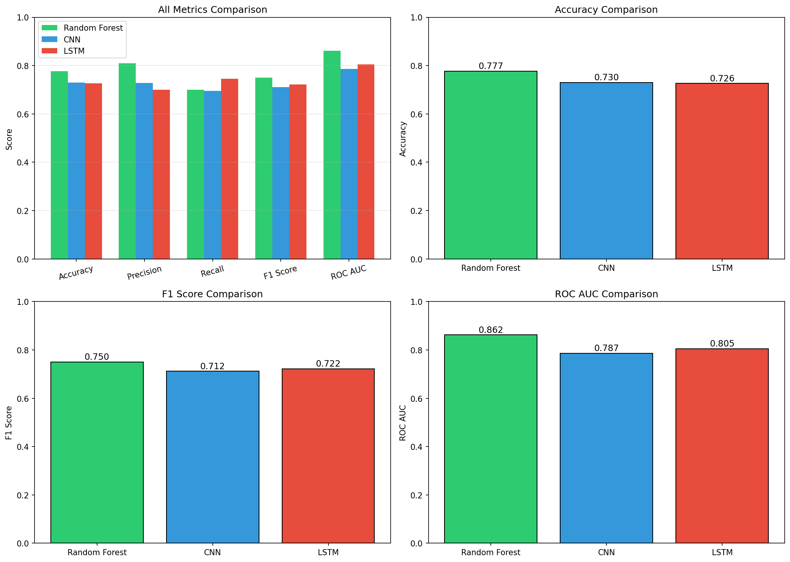

# Tornado Prediction from Weather Data

Predicting tornado occurrence in Texas from ERA5 weather reanalysis and NOAA storm records, comparing a classical model with two neural networks.

Course project for DALAS (Data Science, Learning and Applications), M1 Computer Science, Sorbonne University, 2025-2026.

## What it does

Each sample is a location and date, labelled tornado or non-tornado. The features describe the weather around that location over the five days leading up to the date: wind components, temperature, precipitation, cloud cover and others, summarised as mean and standard deviation in four quadrants (NW, NE, SW, SE).

The notebook:

1. Downloads tornado records from the NOAA Storm Events Database and weather fields from the ERA5 reanalysis (Copernicus Climate Data Store).
2. Combines them with pre-processed quadrant features into one dataset of 5,633 samples (2,693 tornado, 2,940 non-tornado) and 640 features.
3. Trains and evaluates three models on the same split: a Random Forest, a 1D convolutional network over the feature layout, and an LSTM over the five-day sequence.

## Results

Test-set metrics from the run saved in `results/results.json`:

| Model | Accuracy | Precision | Recall | F1 | ROC-AUC |
|---|---|---|---|---|---|
| Random Forest | 0.781 | 0.800 | 0.722 | 0.759 | 0.862 |
| 1D CNN | 0.761 | 0.785 | 0.690 | 0.734 | 0.824 |
| LSTM | 0.603 | 0.588 | 0.568 | 0.578 | 0.648 |

The Random Forest was the strongest model. With a few thousand samples of tabular summary statistics, the neural networks had no advantage, and the LSTM in particular did not learn much from a five-step sequence.



## Data

The data is not included in this repository.

- **NOAA Storm Events Database**: tornado records, fetched by the notebook.
- **ERA5 reanalysis**: fetched by the notebook through the CDS API. This needs a free Copernicus account and an API key in `~/.cdsapirc`.
- **Pre-processed quadrant features**: the feature design (weather variables summarised per quadrant over the days before an event) and the pre-processed feature files follow the paper *Predicting Tornadoes days ahead with Machine Learning* and its public repository. Place `features_4Q_days0-4.csv` and `labels_4Q_days0-4.csv` in `data/processed/`.

## Running it

```bash
python3 -m venv venv
source venv/bin/activate
pip install -r requirements.txt
jupyter notebook tornado_prediction.ipynb
```

The notebook writes models, predictions and figures to `outputs/`.

## Authors

Abdullah Sheikh and Sheharyar
